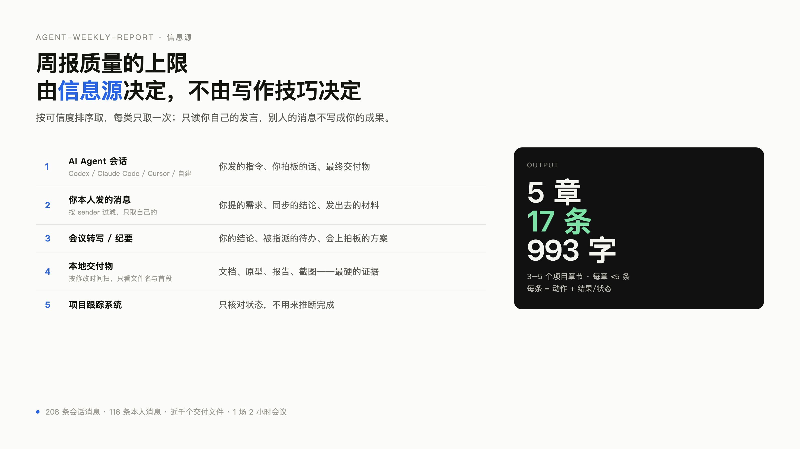
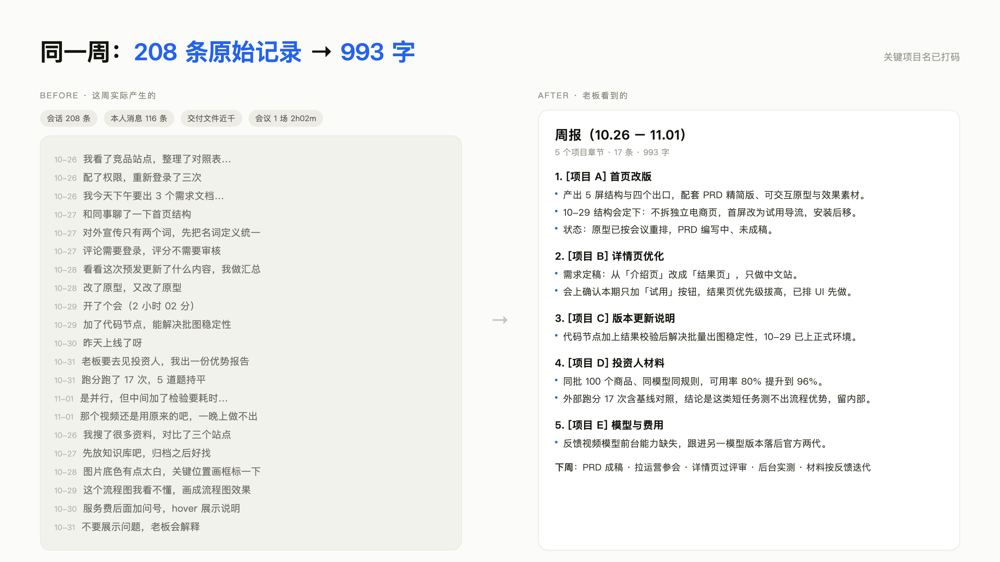
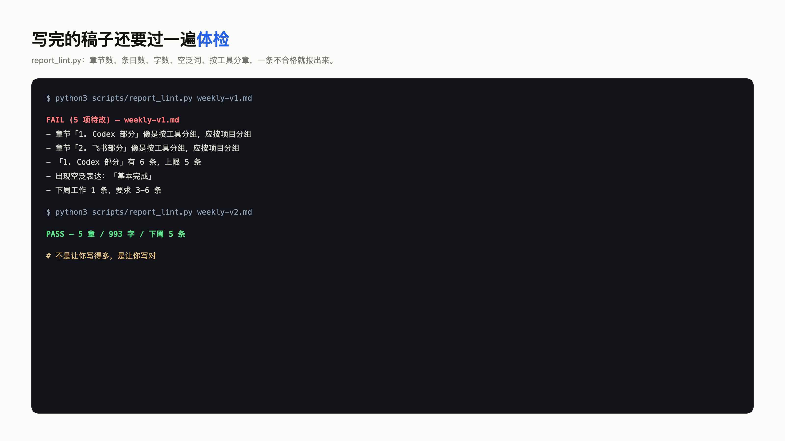

# agent-weekly-report

**Your AI writes you a page of summary. Your boss needs five lines.**

A skill for turning a week of agent sessions, your own chat messages, meeting transcripts and local deliverables into a weekly report that a leader can actually read — 3–5 project sections, ≤5 bullets each, ≤1200 characters.

> 中文说明为主，文末有 English TL;DR。

---

## 问题：AI 的总结不是周报

AI 很擅长把上下文全写出来。但读周报的人（老板、协作方、投资人）**上下文越少，信息越多越像噪音**——看完一页，仍然不知道这个人到底做成了什么、卡在哪、下周靠不靠得住。

我试过的失败形态，和你大概一样：

- **按工具分章**：Codex 一节、飞书一节、项目管理平台一节。读者只能看到你用了什么软件。
- **把过程当成果**：「梳理了背景、对齐了口径、开了个会」。这些不是结果，除非后面跟着一个决定。
- **抢功**：别人写的代码，周报里变成「完成开发」。
- **把待办写成已完成**：讨论过、写在文档里 ≠ 上线了。
- **长列表代替判断**：20 条并列，等于没写。

## 做法：先定输出形状，再去找素材

素材永远过量，形状决定要删什么。这个 skill 的硬约束写在 `SKILL.md` 里，不可协商：

| 约束 | 数值 |
|---|---|
| 项目章节 | 3–5 个 |
| 每章条目 | ≤5 条 |
| 正文长度 | ≤1200 字（目标 800） |
| 下周工作 | 3–6 条 |
| 每条格式 | 动作 + 结果/状态 |

然后按五步走：

1. **划定范围**：时间窗、归属边界、排除清单、交付形态，先写死。
2. **拉信息源**：按可信度排序取，每类只取一次。
3. **建证据表**：项目 / 我做了什么 / 产出 / 状态 / 证据 / 归属 / 计不计入。
4. **归并与收敛**：同源合并、按项目分组、动词降级、砍到形状（四把刀）。
5. **交付与自检**：八问自检，三种交付形态任选。

## 信息源（这个 skill 真正的优势）

周报质量的上限由信息源决定，不是由写作技巧决定。它按顺序吃这五类：

| 顺位 | 信息源 | 取什么 | 为什么排这个位置 |
|---|---|---|---|
| 1 | **AI Agent 会话**（Codex / Claude Code / Cursor / 自建 Agent） | 你本人发的指令、你拍板的话、Agent 的最终交付 | 你 80% 的真实意图留在这里，且只有你这一侧，噪音最低 |
| 2 | **你本人发的消息**（飞书 / Slack 等，按 sender 过滤） | 你提的需求、你同步的结论、你发出去的材料 | 用来确认「推动」与「对外承诺」，只取自己的，不抢功 |
| 3 | **会议转写 / 纪要** | 你的结论、你被指派的待办、会上拍板的方案 | 会上定了但没落文档的，正好在这里 |
| 4 | **本地交付物** | 时间窗内新增/修改的文档、原型、报告、截图 | 最硬的证据：文件在、链接在，才敢写「完成」 |
| 5 | **项目跟踪系统** | 只核对状态，不推断完成 | 「开发中」不等于做完了 |

> 关键设计：**只读你自己的发言**。别人的消息可以当背景，但不能写成你的成果；没权限读就不猜，写「待核实」。

## 效果

一次真实的一周（脱敏示例见 `examples/`）：

- 输入：**208 条** Agent 会话消息（Codex / Claude Code / Cursor / DSH）+ **116 条**本人消息 + 近千个交付文件 + **1 场** 2 小时会议
- 输出：**5 个项目章节 / 17 条 / 993 字**，老板三分钟读完
- 修改次数：从「按工具分章、每条都是过程」改到「按项目分章、每条都是结果」，两轮







## 安装

这个 skill 就是一组 Markdown + Python 脚本，任何能读文件的 Agent 都能用。

**Claude Code / 兼容 `.claude/skills` 的 Agent**

```bash
git clone https://github.com/daffffffffffffff/agent-weekly-report.git \
  ~/.claude/skills/agent-weekly-report
```

**Codex**

```bash
git clone https://github.com/daffffffffffffff/agent-weekly-report.git \
  ~/.codex/skills/agent-weekly-report
```

**其他 Agent（DSH / Cursor / 自建）**

克隆到你的 skills 目录，或在系统提示里直接引用 `SKILL.md`。

## 用法

直接说人话：

```
帮我写这周的周报，从我的 Agent 会话和飞书消息里找
上周的周报，只写公司项目
把这一周的记录收敛成老板三分钟能看完的版本
```

Agent 会按 `SKILL.md` 的五步走。也可以手动跑脚本：

```bash
# 1. 扫 Agent 会话（Codex / Claude Code / Cursor 自动识别）
python3 scripts/scan_agent_sessions.py --start 2026-10-26 --end 2026-11-02 -o /tmp/sessions.json

# 2. 只导出你自己发的消息（飞书，需要 lark-cli 已登录）
python3 scripts/digest_own_messages.py \
  --start 2026-10-26T00:00:00+08:00 --end 2026-11-02T00:00:00+08:00 \
  --output /tmp/my_messages.json

# 3. 写完体检：章节数、条目数、字数、空泛词、工具分章
python3 scripts/report_lint.py weekly.md
```

`report_lint.py` 会直接告诉你哪里不合格：

```
FAIL (4 项待改) — weekly.md
  - 章节「1. Codex 部分」像是按工具分组，应按项目分组
  - 「1. Codex 部分」有 6 条，上限 5 条
  - 出现空泛表达：「基本完成」
  - 下周工作 1 条，要求 3-6 条
```

## 三种交付形态

| 形态 | 用途 | 长度 |
|---|---|---|
| 正文版 | 发给直属领导、团队群 | ≤1200 字，3–5 章 |
| 汇报字段版 | 公司周报系统、OKR 复盘（本周业绩 / 下周计划 / 风险与需支持） | 每字段 ≤2 行 |
| 口头版 | 站会、电梯、电话 | 三句话：做成了什么 / 卡在哪 / 要什么 |

## 换成你自己的信息源

`references/sources.md` 写了每类信息源的取法。换成你自己的只需要改两处：

- **Agent 会话目录**：`scripts/scan_agent_sessions.py` 顶部的 `DEFAULT_ROOTS`。
- **IM 导出**：`scripts/digest_own_messages.py` 用 `lark-cli`，换成 Slack / 企业微信只需替换取消息那一步，保留「只取 sender == 我」的过滤。

## 目录结构

```
agent-weekly-report/
├── SKILL.md                    # Agent 主指令：输出契约 + 五步流程 + 反模式
├── references/
│   ├── sources.md              # 五类信息源的取法与命令
│   ├── evidence.md             # 证据表、归属判定、状态词表
│   ├── condense.md             # 从 300 行到 30 行：四把刀 + 句式库
│   ├── output.md               # 三种交付形态与模板
│   └── checklists.md           # 发布前自检八问
├── scripts/
│   ├── scan_agent_sessions.py  # 扫 Codex / Claude Code / Cursor 会话
│   ├── digest_own_messages.py  # 只导出本人消息（飞书 lark-cli）
│   └── report_lint.py          # 周报体检
├── examples/
│   ├── raw-material-example.md # 脱敏的原始素材
│   └── report-example.md       # 收敛后的成稿
└── assets/                     # 截图
```

## 三条使用建议

- **每周五下午跑一次**，别攒到周一。会话越新，你对「哪些是噪音」的判断越准。
- **先把排除清单写死**。AI 不会替你判断什么不该写，除非你告诉它。
- **你亲自改第一句**。周报的价值密度由第一句决定，第一句必须是结论。

## English TL;DR

AI produces summaries; leaders need judgments. This skill turns a week of **agent sessions + your own chat messages + meeting transcripts + local deliverables** into a weekly report capped at **5 project sections × 5 bullets, ≤1200 characters**, with an evidence table that keeps you from taking credit for other people's work and from describing plans as shipped. Ship it: `SKILL.md` + 5 references + 3 scripts, no dependencies beyond Python 3.

## License

MIT
